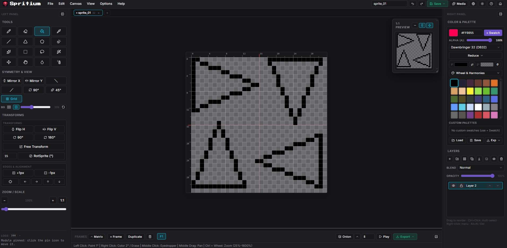

# Spritium (`v0.9.0-beta.5`)

[English](./README.md) | [Español](./README.es.md)

> **Estudio Web de Pixel Art 100% Client-Side con cuantización perceptual OKLab, sistema de capas, timeline matriz, Tilemaps, idioma ES/EN y exportación multi-formato.**

[](#estado-beta-y-comunidad)
[](./LICENSE)
[](https://discord.gg/cxPmhUNFPj)
[](#soporte-de-navegadores-y-plataformas)



**Spritium** es un estudio de pixel art y animación de sprites 100% client-side construido sobre HTML5 Canvas 2D, sin build ni dependencias externas. Creá, importá, cuantizá, animá y exportá sprites y tilemaps directo desde tu navegador con persistencia local en **IndexedDB** — sin servidor, sin cuentas y sin instalación.

* **App en Vivo (GitHub Pages):** [gastonmonsalvo.github.io/spritium](https://gastonmonsalvo.github.io/spritium/)
* **Guía de Uso (Atajos, Mouse y Herramientas):** [Guía de Uso](./docs/index.html?doc=HELP.md)
* **Historial de Cambios:** [CHANGELOG.md](./CHANGELOG.md)
* **Comunidad y Soporte:** [Sumate al Discord](https://discord.gg/cxPmhUNFPj)

---

## Funcionalidades Principales

### 1. Importación, Tilemaps y Cuantización Perceptual (OKLab + Bayer)
* **Resoluciones soportadas:** presets desde `16×16` hasta `512×512` y tamaño personalizado `N × M` (`4–512 px`) desde **Edición → Resolución**.
* **Apertura 1:1, Pegado desde Portapapeles (`Ctrl+V`) y Conversión a Pixel Art:** abrí PNGs en tamaño real `1:1`, pegá imágenes directo desde el portapapeles del sistema al importador, convertí imágenes a pixel art con vista previa en vivo y quitá el fondo conectado opcionalmente.
* **Importador de Tilemaps:** importá hojas de tileset o mapas completos (`PNG + JSON` / Tiled `.tmj`) con deduplicado instantáneo y reordenamiento Drag & Drop.
* **Paletas integradas + Custom Palettes:** **Dawnbringer 32 (DB32)**, **DB16**, **PICO-8**, **Arne 16**, **DMG-01 (Game Boy)**, **Terminal 1-Bit**, **Grayscale (16)** e **Indexed (16)**, usando cuantización perceptual en **OKLab** y **Dithering ordenado (Bayer 4×4 / 8×8)** opcional.
* **Reducción Adaptativa de Paleta:** K-Means++ ponderado en OKLab (`16 / 24 / 32 / 48 / 64` colores propios) con re-ajuste no destructivo.

### 2. Capas, Timeline Matriz y Animación
* **Capas y Carpetas:** blend modes (`Normal`, `Multiply`, `Screen`, `Overlay`, `Darken`, `Lighten`, `Color Dodge`, `Color Burn`), opacidad por capa, multiselección (`Ctrl+Clic`), bloqueo, Drag & Drop y renombrado inline (`Doble clic` / `F2`).
* **Movimiento No Destructivo:** mover, rotar (`RotSprite`) o transformar libremente (`Shift+T`) conserva los píxeles fuera de cuadro por capa sin recortarlos.
* **Timeline Matriz (`Matriz ^`):** grilla expandible de **Capas × Frames** con controles de reproducción, **Tag Frames** con loop por tag, **Linked Cels**, Drag & Drop y **Onion Skin Pro** (opacidad regulable, rango Prev/Next y **Modo Rojo / Azul**).
* **Exportación Multi-Formato:** vista previa en vivo, escala *Nearest-Neighbor* (`1×–16×`), **GIF Animado** (LZW 100% client-side), **Tira PNG** (`Fila` / `Columna` / `Grilla N×M`), **Atlas (PNG + JSON)** y archivos de proyecto `.spritium`.

### 3. Herramientas, Simetría 2.0 y Guías de Precisión
* **Herramientas y Pinceles Custom:** **Lápiz (`B`)** con **Pixel-Perfect**, **Línea (`L`)** (recta a 45° o curvas Bézier), **Formas (`R`/`C`/`U`)**, **Polígono (`N`) y Contorno (`O`)** con relleno Scanline Even-Odd, **Tarro (`T`/`F`)**, **Shading OKLab (`K`)**, **Blur / Jumble / Ruido** (`Mono` / `Color` / `B&N`), **Spray**, **Gotero (`I`)**, **Goma (`E`)** y pinceles propios `.sbrush.json`.
* **Simetría 2.0:** Horizontal (`X`), Vertical (`Y`), Diagonales (`╲` / `╱`) y Radial (`90°` / `45°`), con modo de centro **par (2px) / impar (1px corazón)**, posicionamiento libre del eje (`Alt+Clic/Arrastrar` o coordenadas) y centrado sobre selección.
* **Reglas, Guías y Fondo de Trabajo:** reglas en píxeles, guías arrastrables y fondo personalizable con picker RGBA/Alpha y alternancia Damero ↔ Sólido.
* **Color RGBA y Paletas:** soporte completo `#RRGGBBAA`, Rueda HSV con armonías cromáticas e importación/exportación `.hex`, `.gpl`, `.pal` y `.json`.
* **Selección Booleana y Mira CS:** Rectángulo, Elipse y Triángulo (`S`), Lazo (`Q`), Varita Mágica (`W`), Transformación Libre (`Shift+T`), vista previa en vivo (`V`) y códigos compartibles de mira (`SPR-XXXX-XXXX-XXXX`).

### 4. Experiencia de Estudio e Idioma
* **Cambio de idioma en vivo (`ES / EN`):** interfaz, paletas y guía de usuario traducidas en tiempo real.
* **Pestañas Multi-Documento y Guardado Real:** menú contextual en pestañas (Duplicar, Renombrar, Guardar, Cerrar lote), checkpoints automáticos locales en **IndexedDB** y guardado directo en disco (`Alt+S` / `Alt+Shift+S`) en navegadores compatibles.
* **Paneles Acoplables / Flotantes, Temas y Escala de UI:** arrastrá módulos entre bordes o dejalos flotantes, alterná tema **Oscuro / Claro / Win98** y ajustá la escala (`100%`, `115%`, `135%`).

---

## Soporte de Navegadores y Plataformas

| Plataforma / Navegador | Nivel de Soporte | Detalle |
|---|---|---|
| **Chrome / Edge / Brave (Desktop)** | Completo (Recomendado) | Guardado y sobrescritura directa en disco (`Alt+S` / `Alt+Shift+S`) vía File System Access API. |
| **Firefox / Safari (Desktop)** | Completo (Fallback descarga) | Todas las herramientas operativas; guardar `.spritium` descarga copia en `Descargas/`. |
| **Android (Chrome) e iOS (Safari)** | Táctil Beta | Protección anti-mancha en *pinch-to-zoom*, dock móvil rápido, paneles adaptativos y descarga `.spritium`. *(Para sesiones largas sigue siendo más cómodo en Desktop.)* |

---

## Preguntas Frecuentes (FAQ)

<details>
<summary><strong>¿Necesito instalar algo o crear una cuenta?</strong></summary>

No. Spritium corre 100% en tu navegador desde [GitHub Pages](https://gastonmonsalvo.github.io/spritium/) o un servidor HTTP local.

</details>

<details>
<summary><strong>¿Spritium sube mis sprites o imágenes a algún servidor?</strong></summary>

No. Todo el procesamiento, cuantización OKLab, exportación GIF y checkpoints ocurren localmente en tu dispositivo vía Canvas 2D e IndexedDB. Solo se adjunta un snapshot si vos decidís enviar un reporte desde **Ayuda → Enviar Feedback**.

</details>

<details>
<summary><strong>¿Cómo se guardan mis proyectos y qué cambia con <code>Alt+S</code> en Chrome vs Firefox?</strong></summary>

En navegadores Chromium de escritorio, **Guardar (`Alt+S`)** vincula el archivo `.spritium` local con File System Access API para sobrescribir directo sin duplicar copias (y `Alt+Shift+S` para *Guardar como...*). En Firefox, Safari y móvil descarga una copia `.spritium` de forma segura.

</details>

<details>
<summary><strong>¿Qué formatos puedo importar y exportar?</strong></summary>

Importá `.spritium`, PNG/JPG/WebP/GIF/BMP, tilemaps `.tmj` (Tiled) y paletas `.hex` / `.gpl` / `.pal` / `.json`. Exportá PNG (`1×–16×`), GIF animado, Tiras PNG, Atlas (`PNG + JSON`) y `.spritium`.

</details>

<details>
<summary><strong>¿Qué hago si encuentro un bug?</strong></summary>

Usá **Ayuda → Enviar Feedback / Reportar Bug** dentro de la app (adjunta pasos reproducibles automáticamente), abrí un [Issue en GitHub](https://github.com/gastonmonsalvo/spritium/issues) o escribinos en [Discord](https://discord.gg/cxPmhUNFPj).

</details>

---

## Estado Beta y Comunidad

Spritium se encuentra actualmente en **Beta pública (`v0.9.0-beta.5`)**. Las herramientas principales son estables para producción, pero seguimos puliendo detalles y testeando fuerte.

* **Discord:** Sumate a nuestra [Comunidad en Discord](https://discord.gg/cxPmhUNFPj) para compartir sprites, dudas o sugerencias.
* **Feedback integrado:** **Ayuda → Enviar Feedback / Reportar Bug** directo desde el editor.
* **GitHub Issues:** [gastonmonsalvo/spritium/issues](https://github.com/gastonmonsalvo/spritium/issues).

---

## Licencia

El código propio de Spritium está licenciado bajo **MIT License** — ver [LICENSE](./LICENSE). Los avisos y licencias de terceros se detallan en [THIRD_PARTY_NOTICES.md](./THIRD_PARTY_NOTICES.md).

---

## Ejecución Local

Como Spritium usa ES Modules nativos (`<script type="module">`), abrir `index.html` con doble clic (`file://`) será bloqueado por la política CORS del navegador. Serví la carpeta con un servidor HTTP local:

* **VS Code (la más rápida):** instalá la extensión [Live Server](https://marketplace.visualstudio.com/items?itemName=ritwickdey.LiveServer), hacé clic derecho en `index.html` y elegí **Open with Live Server**.
* **Terminal (Python):**
  ```bash
  python -m http.server 8000
  ```
  Y abrí [http://localhost:8000](http://localhost:8000).
