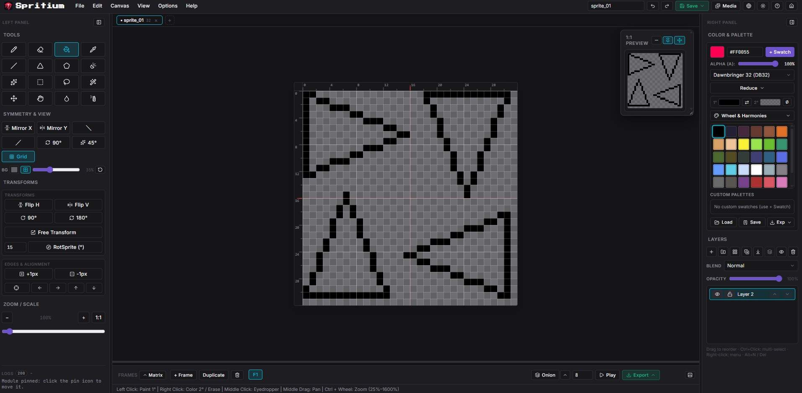

# Spritium (`v0.9.0-beta.6`)

[English](./README.md) | [Español](./README.es.md)

> **100% Client-Side Web Pixel Art Studio with OKLab perceptual quantization, layers, matrix animation timeline, Tilemaps, ES/EN localization, and multi-format export.**

[](#beta-status)
[](./LICENSE)
[](https://discord.gg/cxPmhUNFPj)
[](#browser--platform-support)



**Spritium** is a zero-build, 100% client-side pixel art and sprite animation studio built on HTML5 Canvas 2D. Create, import, quantize, animate, and export sprites and tilemaps directly in your browser with local **IndexedDB** persistence — no backend, no account, and no installation required.

* **Live App (GitHub Pages):** [gastonmonsalvo.github.io/spritium](https://gastonmonsalvo.github.io/spritium/)
* **User Guide (Shortcuts, Mouse & Tools):** [User Guide](./docs/index.html?doc=HELP.md)
* **Changelog:** [CHANGELOG.md](./CHANGELOG.md)
* **Community & Support:** [Join our Discord](https://discord.gg/cxPmhUNFPj)

---

## Key Features

### 1. Import, Tilemaps & Perceptual Quantization (OKLab + Bayer)
* **Supported resolutions:** presets from `16×16` up to `512×512`, plus custom `N × M` (`4–512 px`) from **Edit → Resolution**.
* **1:1 Open, Clipboard Paste (`Ctrl+V`) & Pixel Art Conversion:** open PNG sprites at native `1:1` size, paste OS clipboard images directly into the canvas import modal, convert high-res images to pixel art with live preview, and optionally remove connected backgrounds.
* **Tilemap Importer:** import tileset sheets or full tilemaps (`PNG + JSON` / Tiled `.tmj`) with instant tile deduplication and Drag & Drop reordering.
* **Built-in + Custom Palettes:** **Dawnbringer 32 (DB32)**, **DB16**, **PICO-8**, **Arne 16**, **DMG-01 (Classic Handheld)**, **Terminal 1-Bit**, **Grayscale (16)**, and **Starter 16 (Base Palette)**, using **OKLab** perceptual quantization and optional **Bayer 4×4 / 8×8** ordered dithering.
* **Adaptive Palette Reduction:** weighted K-Means++ in OKLab (`16 / 24 / 32 / 48 / 64` colors) with non-destructive re-adjustment.

### 2. Layers, Matrix Timeline & Animation
* **Layers & Folders:** blend modes (`Normal`, `Multiply`, `Screen`, `Overlay`, `Darken`, `Lighten`, `Color Dodge`, `Color Burn`), per-layer opacity, multi-select (`Ctrl+Click`), locking, Drag & Drop, and inline renaming (`Double click` / `F2`).
* **Non-Destructive Movement:** moving, rotating (`RotSprite`), or free-transforming (`Shift+T`) preserves out-of-bounds pixels per layer without clipping.
* **Matrix Timeline (`Matrix ^`):** expandable **Layers × Frames** grid with playback transport, **Frame Tags** with per-tag looping, **Linked Cels**, Drag & Drop, and **Onion Skin Pro** (adjustable opacity, Prev/Next range, and **Red / Blue** tinting).
* **Multi-Format Export:** live preview, *Nearest-Neighbor* scaling (`1×–16×`), **Animated GIF** (100% client-side LZW), **PNG Strip** (`Row` / `Column` / `Grid N×M`), **Atlas (PNG + JSON)**, and `.spritium` project files.

### 3. Drawing Tools, Symmetry 2.0 & Precision Guides
* **Tools & Custom Brushes:** **Pencil (`B`)** with **Pixel-Perfect**, **Line (`L`)** (45° snap or Bézier curves), **Shapes (`R`/`C`/`U`)** (`Alt` center-out), **Polygon (`N`) & Contour (`O`)** with Scanline Even-Odd fill, **Bucket (`T`/`F`)**, **OKLab Shading (`K`)**, **Blur / Jumble / Noise** (`Mono` / `RGB` / `B&W`), **Spray**, **Eyedropper (`I`)**, **Eraser (`E`)**, **Zoom (`Z` / `1–8` / `0`)**, **Advanced 8-way Outline**, and custom `.sbrush.json` brushes.
* **Symmetry 2.0:** Horizontal (`X`), Vertical (`Y`), Diagonals (`╲` / `╱`), and Radial (`90°` / `45°`), with **2px even / 1px odd (Heart)** center modes, free axis positioning (`Alt+Click/Drag` or coordinates), and selection-centered symmetry.
* **Rulers, Sub-Grid (`N×M`), Snap & Workspace Background:** pixel rulers, draggable reference guides, custom `N×M` sub-grid with tool snapping and Lock-to-Cell painting, plus customizable workspace background (RGBA/Alpha picker + Checkerboard/Solid toggle).
* **RGBA Color & Palette Tools:** full `#RRGGBBAA`, HSV Wheel with color harmonies, and `.hex` / `.gpl` / `.pal` / `.json` import/export.
* **Boolean Selection & CS Crosshair:** Rectangle, Ellipse & Triangle (`S`), Lasso (`Q`), Magic Wand (`W`), Free Transform (`Shift+T`), live tool preview (`V`), and shareable CS-style mouse reticle codes (`SPR-XXXX-XXXX-XXXX`).

### 4. Studio Experience & Localization
* **Live ES / EN switching:** instant interface, palette, and guide translation.
* **Multi-Document Tabs & Direct Save:** right-click tab menu (Duplicate, Rename, Save, Batch Close), automatic local **IndexedDB** checkpoints, and direct disk save (`Alt+S` / `Alt+Shift+S`) on supported desktop browsers.
* **Dockable / Floating Panels, Themes & UI Scale:** drag panels between edges or float them, switch **Dark / Light / Win98** themes, and scale UI (`100%`, `115%`, `135%`).

---

## Browser & Platform Support

| Platform / Browser | Support Level | Notes |
|---|---|---|
| **Chrome / Edge / Brave (Desktop)** | Full (Recommended) | Direct disk save/overwrite (`Alt+S` / `Alt+Shift+S`) via File System Access API. |
| **Firefox / Safari (Desktop)** | Full (Download Fallback) | All editor tools supported; `.spritium` saves download as a file copy. |
| **Android (Chrome) & iOS (Safari)** | Touch Beta | Pinch-to-zoom protection, mobile quick dock, responsive drawers & download save. *(Desktop is still recommended for heavy pixel work.)* |

---

## FAQ

<details>
<summary><strong>Do I need to install anything or create an account?</strong></summary>

No. Spritium runs 100% in your browser from [GitHub Pages](https://gastonmonsalvo.github.io/spritium/) or any local HTTP server.

</details>

<details>
<summary><strong>Does Spritium upload my sprites or images to a server?</strong></summary>

No. All pixel editing, OKLab quantization, GIF encoding, and checkpoints run locally on your device via Canvas 2D and IndexedDB. A project snapshot is only sent if you voluntarily submit a bug report via **Help → Send Feedback**.

</details>

<details>
<summary><strong>How are projects saved? Why does <code>Alt+S</code> behave differently in Chrome vs Firefox?</strong></summary>

In Chromium desktop browsers, **Save (`Alt+S`)** links to your local `.spritium` file via the File System Access API so future saves write directly to disk without duplicates (use `Alt+Shift+S` for *Save As*). In Firefox, Safari, and mobile browsers, it falls back cleanly to downloading a `.spritium` copy.

</details>

<details>
<summary><strong>What formats can I import and export?</strong></summary>

Import `.spritium`, PNG/JPG/WebP/GIF/BMP, Tiled `.tmj` tilemaps, and `.hex` / `.gpl` / `.pal` / `.json` palettes. Export PNG (`1×–16×`), Animated GIF, PNG Strips, Atlases (`PNG + JSON`), and `.spritium`.

</details>

<details>
<summary><strong>What should I do if I hit a bug?</strong></summary>

Use **Help → Send Feedback / Report Bug** inside the app (it attaches steps and diagnostics automatically), open a [GitHub Issue](https://github.com/gastonmonsalvo/spritium/issues), or ask in our [Discord](https://discord.gg/cxPmhUNFPj).

</details>

---

## Beta Status & Community

Spritium is currently in **public Beta (`v0.9.0-beta.6`)**. Core features are ready for production use, while active improvements and testing continue.

* **Discord:** Ask questions, share sprites, and report issues in our [Discord Community](https://discord.gg/cxPmhUNFPj).
* **In-App Feedback:** **Help → Send Feedback / Report Bug** directly from the editor.
* **GitHub Issues:** [gastonmonsalvo/spritium/issues](https://github.com/gastonmonsalvo/spritium/issues).

---

## License

Spritium-authored code is licensed under the **MIT License** — see [LICENSE](./LICENSE) for details. Third-party assets and notices are listed in [THIRD_PARTY_NOTICES.md](./THIRD_PARTY_NOTICES.md).

---

## Running Locally

Because Spritium uses native ES Modules (`<script type="module">`), opening `index.html` directly via `file://` will be blocked by browser CORS policies. Serve the folder over a local HTTP server instead:

* **VS Code (easiest):** install the [Live Server](https://marketplace.visualstudio.com/items?itemName=ritwickdey.LiveServer) extension, right-click `index.html`, and select **Open with Live Server**.
* **Terminal (Python):**
  ```bash
  python -m http.server 8000
  ```
  Then open [http://localhost:8000](http://localhost:8000).
